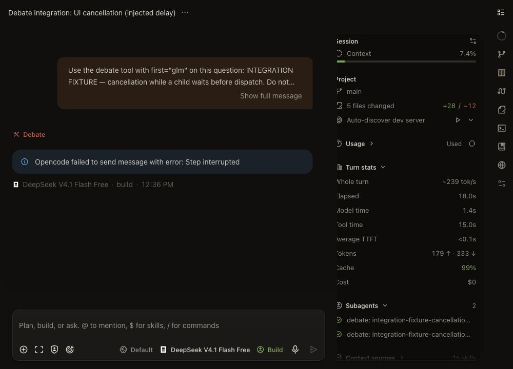
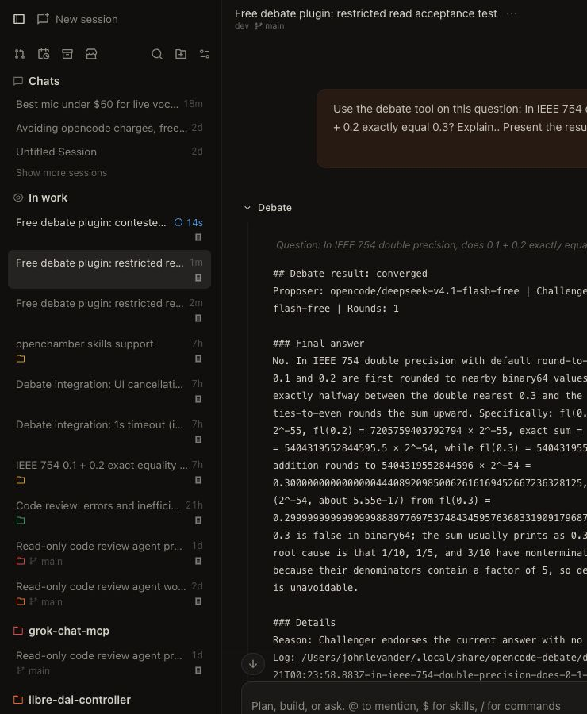

# Phase 3 integration results

Tested 2026-10-20 with OpenCode 2.0.32 and the installed OpenChamber front end. The approved global plugin and command symlinks point to this repository. Global `opencode.json(c)` and agent files were not edited. Both free model IDs were available in the server inventory.

## Outcome

The plugin loads and the control paths work, but the requested free-model debates cannot currently produce an opening answer. Actual child requests inside OpenCode fail with `provider.auth` / `FreeTierError`. The required hidden `debater` has deny-all permissions and no outgoing tool declarations. This behavior matches [OpenCode issue #51241](https://github.com/anomalyco/opencode/issues/51241), which reports free-tier rejection when read/shell tools are denied. The exact gateway decision is not visible locally; the upstream match is a diagnosis, not proof of its internal implementation.

No tools were enabled or fabricated to bypass that restriction. No paid requests were made. Phase 4 has not started.

## Test results

| Case | Execution | Observed result | Rounds / point history |
| --- | --- | --- | --- |
| IEEE 754: does 0.1 + 0.2 exactly equal 0.3? | Actual `/debate` from OpenChamber | `error`: FreeTierError during P0; repeated with the other model proposing, same failure | 0 / `[]`; convergence unverified |
| Mature open-source scientific software: strict backward compatibility versus breaking API changes | Actual debate tool from OpenChamber | `error`: FreeTierError during P0 | 0 / `[]`; meaningful disagreement/stalemate unverified |
| `callTimeoutMs: 1000` | Real plugin/SDK/UI with an isolated 30-second pre-dispatch delay | `error`: Call timeout after 1000 ms; initial attempt ~1004 ms, retry ~1012 ms; retry carries the required interruption prefix; JSON log written | 0 / `[]` |
| Stop from OpenChamber while a child waits | Real plugin/SDK/UI with the same isolated delay and normal deadlines | `cancelled` log; interrupt requests acknowledged for both children; active Proposer stopped, unstarted Challenger already idle | 0 / `[]` |

The IEEE parent is `ses_ea5df663cffeSFsNJwOYurrrSM`. The contested case used the same parent. The timeout parent is `ses_ea5d70a45ffeLqrrG2JXMGSRRr`; cancellation parent is `ses_ea5d4ab1effeXFU2CZmr83Z8lS`.

The parent session stayed responsive while child work was pending. The timeout tool returned a clean result and the parent finished normally. The UI Stop action stopped the parent step too: OpenChamber displayed “Step interrupted,” while the plugin still finalized its `cancelled` JSON log. This means a UI cancellation does not display the normal result Markdown. Both children appeared under the parent's **Subagents** panel and showed Done afterward. This verifies that relationship, not sidebar indentation.

After the delay's 30-second window elapsed, SDK history reads showed the active children had `outcome: interrupted`, ending in idle events, with no assistant answer. The unstarted Challengers had empty histories. These reads confirm the tested delayed operations did not later produce answers. No deadlock was observed in these paths; the upstream failure prevented verification of successful multi-round provider execution.

## Evidence and scope

Full logs remain outside Git in `~/.local/share/opencode-debate/debates/`:

- IEEE: `2026-10-20T16:24:10.232Z-in-ieee-754-double-precision-does-0-1-0-2-exactly-equal-0-3-expl-9a0d6ff1.json`
- IEEE diagnostic rerun: `2026-10-20T16:27:35.008Z-in-ieee-754-double-precision-does-0-1-0-2-exactly-equal-0-3-expl-f3a2224e.json`
- Contested: `2026-10-20T16:32:03.545Z-should-a-mature-open-source-scientific-software-project-prioriti-fc7982fa.json`
- Timeout: `2026-10-20T16:34:12.785Z-integration-fixture-confirm-the-1000-ms-call-timeout-returns-a-c-c1dbd279.json`
- Cancellation: `2026-10-20T16:36:36.759Z-integration-fixture-cancellation-while-a-child-waits-before-disp-2f94f19d.json`

Timeout children: GLM `ses_ea5d62d45ffewmhGR7hbKTNluv`, DeepSeek `ses_ea5d62cfcffeW0d2BuQo62oIpN`. Cancellation children: GLM `ses_ea5d3fadeffe4X2NP1KWj9Yz5a`, DeepSeek `ses_ea5d3fa94ffe9vRQT3NB8EXT7q`. Every child retains the calling session as `parentID`.

The isolated delay fixture was in the ignored repository `.test-runtime/live-control/.opencode` directory. Its local plugin waited 30 seconds in the debater context hook before dispatch, recording `tools: []`. This exercised genuine SDK waits, engine deadlines, explicit child interruptions, logging, and the OpenChamber Stop action without depending on provider latency. It does **not** establish remote-stream cancellation or real-model agreement. The local `.opencode` fixture directory was renamed to `.opencode-disabled` after the tests so future activation does not load it. Sessions and logs were retained.

Automated isolation remains separate: `npm run check` passes TypeScript and 40 core/adapter/plugin/config/log tests, including scripted convergence, revisions, stalemate, maximum rounds, parser repair, rate limits, timeout/cancellation, ignored SDK signals, and late admission/results. An isolated OpenCode server also verified plugin/agent/command registration before global installation.

## Changes prompted by live testing

- Accept the server's normalized `variant: "default"` when configuration omits a variant; retain validation for actual model/variant changes. Added a regression test.
- Preserve OpenCode's assembled system context while clearing debater tools; the agent still uses the specified system prompt. Preserving that context did not resolve FreeTierError.
- Write per-child interrupt request times, acknowledgment times, returned `interrupted` flags, and acknowledgment errors to final logs. Both timeout/cancellation tests check these records.

Phase 3 is reported with blocked provider acceptance. Approval is required before implementing Phase 4's OpenAI-compatible adapter and mock-server tests. That work would add a selectable backend; it would not itself authorize live paid inference.

## User reproduction — 2026-10-20, 8:06 PM America/New_York

The user's later free-only run reproduced the failure on OpenCode 2.0.32. Log `2026-10-21T00:06:31.445Z-what-is-the-best-microphone-under-50-for-vocal-singing-live-04981d33.json` records DeepSeek as Proposer, GLM as Challenger, zero Challenger rounds, and provider.auth during P0 after 250 ms. Both child interrupt requests were acknowledged as already idle. This is additional evidence of the same rejection, not a successful debate. No paid key/provider is implied by this error alone.

The adapter now appends a specific explanation to this recognizable free-tier error: the request already used an OpenCode child, tool-disabled requests have a reported compatibility issue, and changing tool permissions requires approval. Unrelated authentication errors retain their original diagnosis. Two regression tests cover that distinction. The default remains the user's explicitly selected free OpenCode backend; no permissions were relaxed, no global settings were changed in this diagnostic patch, and no paid inference was performed.

## Approved restricted-read compatibility experiment — 2026-10-20, evening America/New_York

The user approved testing an exception to the original all-tools-disabled requirement: expose only native read, limited to a plugin-owned empty file, while denying all other tools. No global compatibility configuration was changed during the trial.

### Isolation and single-model probe

A repo-local plugin under ignored `.test-runtime/read-compat/` defined a separate hidden test agent and preserved the genuine native read tool. Real `ctx.permission.assert` checks allowed only `empty.txt`, denied `canary.txt`, denied directory reads, and denied shell. A tool-execution guard checked the exact path and verified a zero-byte regular file. The DeepSeek probe succeeded in child `ses_ea42f6dd4ffefjN7NNqwstgkH8` under parent `ses_ea42f6ed9ffeakF24kVwX3LrXe`.

The same isolated agent then completed a real engine debate: DeepSeek P0, GLM C1, status `converged`, one Challenger round, no points. Parent `ses_ea42ca6cfffecNjhznJcZz4w7N`; GLM child `ses_ea42ca56effevEKlz4z9O9ZJYd`; DeepSeek child `ses_ea42ca499ffeukJC0GtuoZ7rwD`. A preceding attempt encountered a transient provider HTTP 429 endpoint-unavailable error; bounded retries were used on the successful attempt. This was real free inference, not scripted model output.

### Actual installed debate tool

After implementation of opt-in `readCompatibility`, a separate repo-local test project `.test-runtime/plugin-read-compat/` enabled it with `low` reasoning variants. The free DeepSeek calling agent invoked the actual installed `debate` tool on OpenChamber's server. Parent `ses_ea428b090ffeo6uM3FMSsnTI2W` returned normally and the result was inspected in the OpenChamber UI.

Log: `2026-10-21T00:23:58.883Z-in-ieee-754-double-precision-does-0-1-0-2-exactly-equal-0-3-expl-eaa001cc.json`. It records `converged` after C1, DeepSeek as Proposer and GLM as Challenger, and empty C1 point history. P0 recovered from two provider rate-limit errors using the engine's bounded retry path. GLM child `ses_ea4281752ffednsJjpZ5cxSpvS`; DeepSeek child `ses_ea42816f0ffe9y5N7OXbLOgk9B`. Both models were the requested free OpenCode IDs. The caller displayed the answer and reported no unresolved points. As previously observed, the calling model can reformat the final presentation even though the tool itself returns the specified Markdown.

A preceding actual-tool attempt, log suffix `c778b283`, ended cleanly after exhausting three endpoint-unavailable attempts. This is separate from the original auth rejection and remains a possible free-service limitation.

The audit hook confirmed each child request advertised exactly `read`. Actual permission checks allowed the asset path and denied a canary file, the current directory, and shell. No debater tool executions occurred in the successful IEEE run. The permanent asset is `assets/compatibility/empty.txt`; its path is recorded in child-session log entries. Unit tests additionally verify symlink/content changes, nearby instruction-file loading, absent native read, hook cleanup, default-off behavior, and unchanged parent tools. TypeScript and all 66 tests pass.

Source checks used the exact v2.0.32 [permission evaluator](https://github.com/anomalyco/opencode/blob/v2.0.32/packages/core/src/permission.ts), [tool availability filter](https://github.com/anomalyco/opencode/blob/v2.0.32/packages/core/src/tool.ts), [file authorization](https://github.com/anomalyco/opencode/blob/v2.0.32/packages/core/src/file-access.ts), and [native read implementation](https://github.com/anomalyco/opencode/blob/v2.0.32/packages/core/src/tool/plugin/read.ts). Session rules follow agent rules, the last matching rule wins, and native read performs its own authorization. Its instruction-file side effect is explicitly guarded by this plugin.

### Contested question in compatibility mode

The actual tool was also tested on scientific-software backward compatibility versus breaking API changes, parent `ses_ea4263454ffeb5M2nKLcMg2Edx`, with GLM proposing and DeepSeek challenging. Log: `2026-10-21T00:26:20.259Z-should-a-mature-open-source-scientific-software-project-prioriti-ca64687a.json`.

The free models produced P0 and C1, so the original auth blocker was absent. C1 introduced seven open points: unclear compatibility tiers, silent semantic/default changes, unmaintained pipelines and frozen environments, numerical correctness versus bit identity, ABI compatibility, questionable examples, and maintainer capacity. P1 returned malformed JSON, then its single JSON repair returned a Challenger-style reply with a null answer. The engine correctly stopped with `error: Invalid JSON twice in P1: Proposer must provide a nonempty answer`, preserving the last valid proposal and all seven open points. Point history is `C1: C1–C7 open`; no revision was accepted, so every Proposer point position remained Not yet addressed. This was not convergence or stalemate, and successful multi-round contested debate is still unverified. C1 recovered from two transient provider rate limits.

The caller displayed the partial answer and unresolved points. This exposes a remaining free-model output/role adherence limitation, distinct from transport authentication. The protocol did not silently accept missing answers or let Proposer output close Challenger objections. No prompt-policy change or retry-budget expansion was made just to force a successful outcome.

After testing, both ignored test fixture `.opencode` directories were renamed `.opencode-disabled` to stop loading their local audit plugins/config on future activation. Logs and sessions are retained. The actual acceptance caller and both IEEE child sessions reported `cost: 0` and the expected free model IDs. The global compatibility flag remains off pending the user's approval of the exact config merge.
